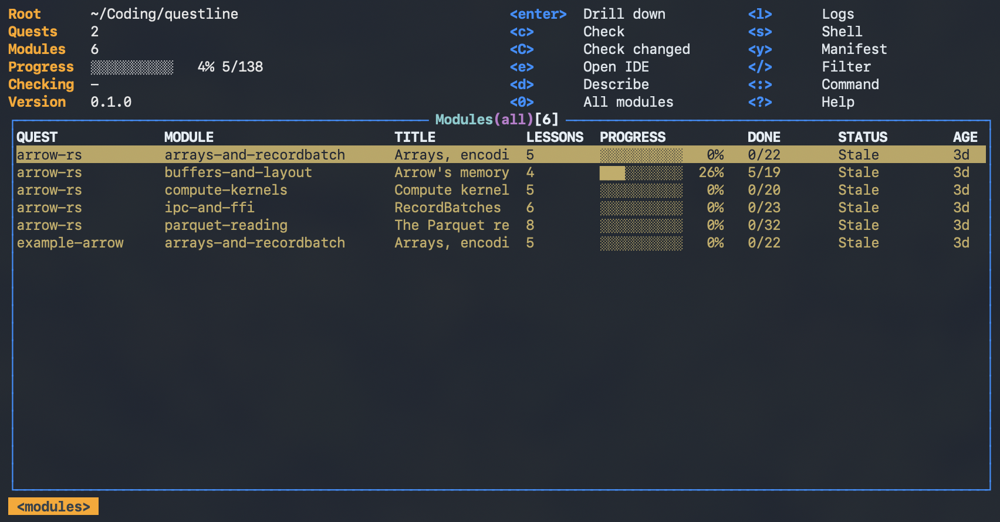

# questline

`questline` is a framework to generate interactive (runnable) Rust courses on 
unfamiliar topics (e.g. `arrow-rs`). It includes
- a Terminal UI for managing quests (courses) and viewing progress
- an agentic skill for generating and registering quests

- A **quest** is a course on one subject (say arrow-rs), a Cargo workspace under `quests/`.
  Its **modules** are sub-courses (parquet-reading, compute-kernels…), one member crate each,
  sharing the workspace's dependency pins and `target/`.
- A module has **lessons** you run (`cargo run -- 1`: a lecture whose claims are checked as it
  runs) and **exercises** you complete, checked by tests (`cargo run -- check 1`, which also
  records your progress).
- `questline` shows every quest and module with its progress, k9s-style: drill down to lessons
  and exercises, re-check what changed, open a module in your IDE, run a lesson.
- [`/questify <topic>`](skills/questify) is an agent skill (Claude Code, Codex, …) that writes a new
  module into the quest on the same subject, or starts a new quest.



## Install

Rust 1.89 or newer.

```bash
git clone https://github.com/jayfeng20/questline && cd questline
cargo install --path crates/questline     # the `questline` binary
questline                                 # the dashboard over ./quests
```

The binary finds its root (the directory holding `quests/`) from `--root`, `$QUESTLINE_ROOT`, the
current directory's ancestors, or the checkout it was installed from.

## Take a quest

The repository ships one example quest, [`quests/example-arrow`](quests/example-arrow):

```bash
cd quests/example-arrow/modules/arrays-and-recordbatch
cargo run -- list         # the syllabus, with your progress
cargo run -- 1            # lesson 1; read src/lessons/l01_*.rs alongside
$EDITOR src/exercises/e01_*.rs
cargo run -- check 1      # run lesson 1's tests and record progress
```

Or from the dashboard: select the module, `e` to open it in your IDE, `r` on a lesson to run it,
`c` to check it. `?` lists every key; they follow k9s (`j`/`k`, `enter`, `esc`, `/` filter,
`:` command, `0` all, `d` describe, `l` logs, `s` shell).

| subcommand | does |
|------------|------|
| `questline [--theme default\|gruvbox-dark\|catppuccin-frappe]` | the dashboard (also `questline tui`); `$QUESTLINE_THEME` sets the default theme |
| `questline list [--json]` | every module with its progress and status |
| `questline eval [quest[/module]…] [--force] [--json]` | check the modules whose files changed; the rest reuse their cached result |
| `questline open <quest[/module]> [--lesson N]` | a new IDE window rooted at the module (`$QUESTLINE_IDE`, else `code`, `cursor`, `zed`, …) |
| `questline validate [dir…]` | check quests against the contract |
| `questline order <quest[/module]> <n>` | move it to position `n` in learning order, renumbering the others |

## Write a quest

Install the skill (a symlink, so it follows the checkout), then ask your agent:

```bash
ln -s "$PWD/skills/questify" ~/.claude/skills/questify   # Codex: ~/.codex/skills/questify
```

```
/questify arrow parquet writing   # autosort: joins the arrow quest if there is one, else creates it
/questify --manual tokio channels # manualsort: asks before creating a quest or module
```

Your quests stay local: everything under `quests/` except the example is gitignored. Any
directory that satisfies [the contract](docs/contract.md) is registered by existing in
`quests/`, so quests can be written by hand too.

## Architecture

```
crates/questkit         the contract: manifests, the lesson runner, `check`, progress.json
                        (linked into every quest module)
crates/questline-core   the backend API: discovery, evaluation, the registry, IDE launch
crates/questline        the CLI and the ratatui dashboard, thin clients of questline-core
quests/                 registered quests (one example published)
skills/questify         the /questify agent skill: workflow, templates, scaffolding, examples
docs/contract.md        what a quest must look like and do to be registered
```

`questline-core` is UI-agnostic: a `Questline` handle (`Send + Sync`) with `sync()`,
`evaluate(targets, force, on_event)`, `set_order(target, position)` and
`open_in_ide(target, lesson)`, returning serde-serializable
snapshots and streaming `EvalEvent`s. The dashboard runs it on a worker thread; a native macOS app
can link the same crate (e.g. through UniFFI) or drive `questline list --json` / `eval --json`.

**Source of truth and cache.** Manifests (`quest.toml`, `module.toml`) and each module's
`.quest/progress.json` (written by `cargo run -- check`, from a terminal or the dashboard) are
the truth. `.questline/registry.parquet` is a materialized view of them, one row per module with
its quest's metadata, syllabus, per-exercise results, a fingerprint of the module's files and
the fingerprint it was last evaluated at. A module whose fingerprint is unchanged is not re-run.
Query it with anything that reads Parquet:

```bash
duckdb -c "select quest_id, module_id, status, passed, total from '.questline/registry.parquet'"
```

## Contributing

Pull requests run `fmt`, `clippy`, tests on Linux and macOS, the MSRV build, the example quest's
lessons and solutions, and the skill's scaffold. MIT licensed.
